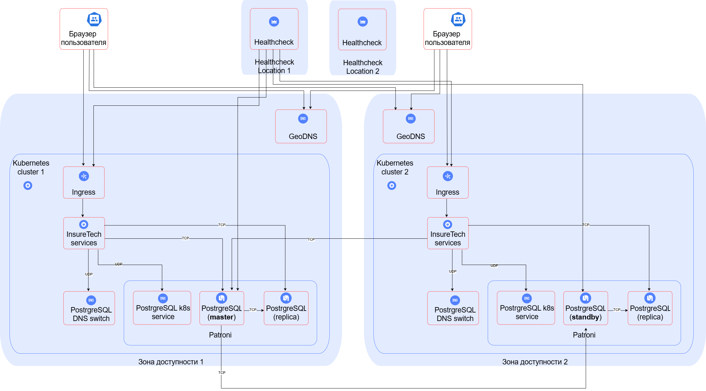

### Описание решения

**Масштабирование** - горизонтальное и для БД и для приложений тк планируется значительный рост количества пользователей и запросов и по всей видимости его тяжело предсказать.

**Отказоустойчивость** обеспечивается наличием нескольких экземпляров приложений в датацентре под управлением k8s, а также наличием нескольких датацентров.

Для выполнения требования обеспечить одинаковое время загрузки страниц для пользователей из разных регионов архитектура предполагает наличие нескольких датацентров - каждый ближе к определённому набору регионов.

**Конфигурация развёртывания приложения в Kubernetes** использует несколько независимых кластеров k8s - "растянутый" кластер сложнее настраивать для автоматического масштабирования (где добавлять поды?), могут быть проблемы с потерей кворума при отказе датацентра и т.п.

**Балансировка нагрузки** использует GeoDNS для привязки пользователей к кластеру, а также для прекращения направления трафика на отказавший датацентр. Healthcheck'и проверки доступности сервисов в датацентрах расположены близко к локациям датацентров, но не в них самих.

**Файловер-стратегия** для приложений - Active-Active.

**Конфигурация баз данных** предполагает наличие одного master в одном из ДЦ, нескольких локальных реплик для чтения, асинхронных реплик в других ДЦ в режиме standby и их локальных реплик. Базы в каждом ДЦ находятся под управлением связки Patroni + k8s, при отказе внутри датацентра переключение автоматическое. Если же отказал датацентр с master, то один из standby превращается в master (promote), сначала standby изолируются от master (fence), см. [документацию Patroni по настройке multi DC](https://patroni.readthedocs.io/en/latest/ha_multi_dc.html?utm_source=chatgpt.com). Таким образом, **файловер-стратегия** для БД - Active-Standby. Процедура ручная, но должна по времени уложиться в RTO. Приложения определяют с каким экземпляром БД соединяться, используя DNS. Для понимания доступности БД используются healthcheck'и в тех же локациях, что и healthcheck'и приложений. Предполагается, что поломка healthcheck в течение 15 минут является безусловным триггером для promote standby, что и обеспечит RPO даже если в дальнейшем выяснится, что датацентр продолжал принимать запросы. Рассматривались варианты с разными master (свой master в каждом датацентре) для БД заявок, но показалось слишком сложным. Хотя master один и задержка обращения к нему из других датацентров будет существенная, use case, предполагающие обращение к master (например создание заявки) менее чувствительны к таким задержкам, а просто для загрузки страниц или БД не используется или можно использовать локальные реплики (например отображение списка заявок и тп). 

**Шардирование БД** применять не планируется, БД небольшая и тк она хранит заявки на страховки (а не, например, какой-то большой поток событий), выглядит, что её размер не "доживёт" до шардирования.

### Схема

