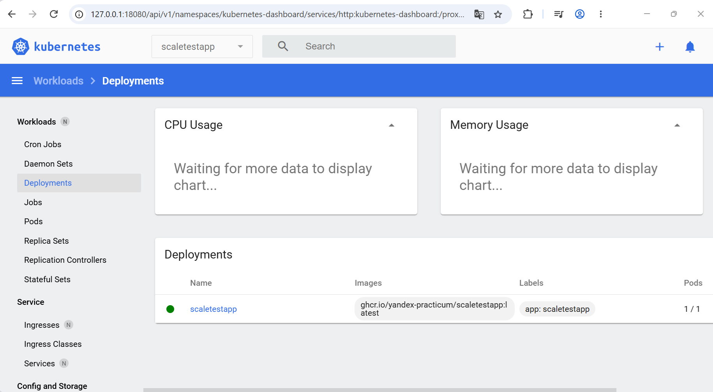
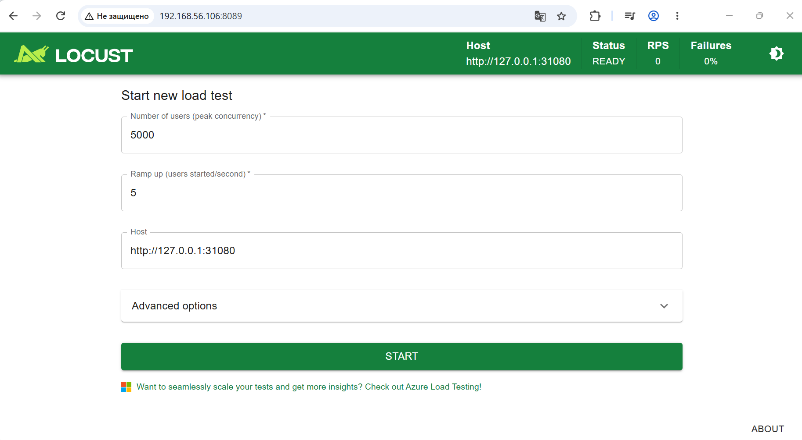
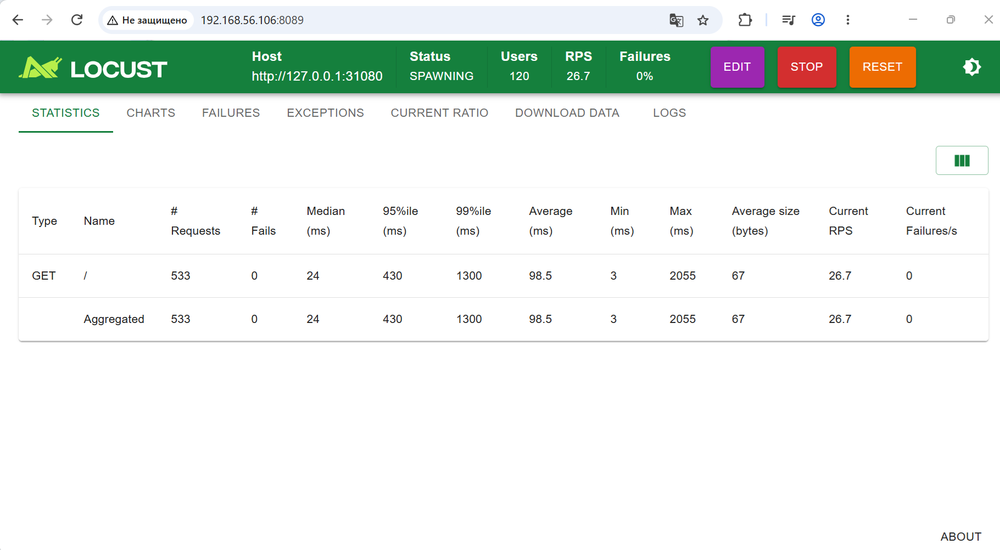
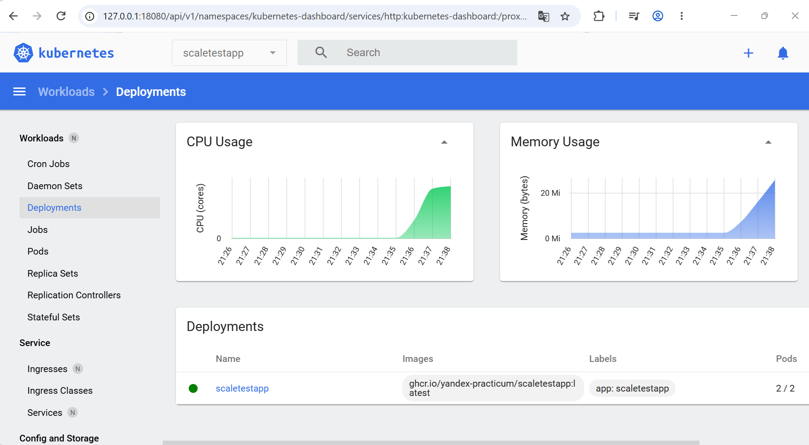

## Тестирование горизонтального масштабирования

### Подготовка

Очищаем окружение:

```
minikube delete
```

Запускаем minikube с дополнениями и нужными конфигурационными параметрами:

```
minikube start --addons=metrics-server --extra-config=controller-manager.horizontal-pod-autoscaler-sync-period=5s
```

Меняем разрешение метрик у metrics-server:

```
minikube kubectl -- patch deployment metrics-server -n kube-system \
  --type=json \
  -p='[{"op":"replace","path":"/spec/template/spec/containers/0/args/4","value":"--metric-resolution=12s"}]'
```

Создаём пространство имён:

```
minikube kubectl -- create namespace scaletestapp
```

Запускаем приложение:

```
minikube kubectl -- apply -f deployment.yaml
```

Проверяем:

```
minikube kubectl -- get pods -n scaletestapp

NAME                            READY   STATUS    RESTARTS   AGE
scaletestapp-5d6cd674cd-rc6zx   1/1     Running   0          22s
```

Настраиваем сервис приложения:

```
minikube kubectl -- apply -f service.yaml
```

Проверяем:

```
minikube kubectl -- get services -n scaletestapp

NAME           TYPE       CLUSTER-IP    EXTERNAL-IP   PORT(S)          AGE
scaletestapp   NodePort   10.96.85.47   <none>        8080:31080/TCP   20s
```

### Масштабирование по используемой памяти

Применяем конфигурацию HPA с масштабированием по памяти:

```
minikube kubectl -- apply -f hpa-memory.yaml
```

Проверяем:

```
minikube kubectl -- get hpa -n scaletestapp

NAME           REFERENCE                 TARGETS          MINPODS   MAXPODS   REPLICAS   AGE
scaletestapp   Deployment/scaletestapp   memory: 8%/80%   1         10        1          21s
```

Делаем приложение доступным на хост-машине, чтобы подавать на неё нагрузку, используя locust:

```
minikube kubectl -- port-forward -n scaletestapp --address 127.0.0.1 svc/scaletestapp 31080:8080

Forwarding from 127.0.0.1:31080 -> 8080
```

**В новом окне**

Проверяем:

```
curl http://127.0.0.1:31080

Идентификатор пода: scaletestapp-5d6cd674cd-rc6zx
```

Запускаем minikube dashboard:

```
minikube dashboard --port=18080 --url

* Enabling dashboard ...
  - Using image docker.io/kubernetesui/dashboard:v2.7.0
  - Using image docker.io/kubernetesui/metrics-scraper:v1.0.8
* Some dashboard features require the metrics-server addon. To enable all features please run:

        minikube addons enable metrics-server

* Verifying dashboard health ...
* Launching proxy ...
* Verifying proxy health ...
http://127.0.0.1:18080/api/v1/namespaces/kubernetes-dashboard/services/http:kubernetes-dashboard:/proxy/
```

**В новом окне**

Запускаем locust:

```
locust

[2026-10-27 21:24:37,093] debian/INFO/locust.main: Starting Locust 2.46.7
[2026-10-27 21:24:37,095] debian/INFO/locust.main: Starting web interface at http://0.0.0.0:8089, press enter to open your default browser.
```

Смотрим в dashboard на количество подов - 1 под:



**В новом окне**

Ещё раз проверяем количество подов (на этот раз из командной строки):

```
minikube kubectl -- get pods -n scaletestapp

NAME                            READY   STATUS    RESTARTS   AGE
scaletestapp-5d6cd674cd-rc6zx   1/1     Running   0          16m
```

Заходим в locuat, ставим Number of users = 5000, Ramp up = 5:



Запускаем тест - нажимаем START и ждём:



Через какое-то время проверяем hpa:

```
minikube kubectl -- get hpa -n scaletestapp

NAME           REFERENCE                 TARGETS           MINPODS   MAXPODS   REPLICAS   AGE
scaletestapp   Deployment/scaletestapp   memory: 93%/80%   1         10        2          21m
```

И количество подов в командной строке и в браузере:

```
minikube kubectl -- get pods -n scaletestapp

NAME                            READY   STATUS    RESTARTS   AGE
scaletestapp-5d6cd674cd-6mc5d   1/1     Running   0          16s
scaletestapp-5d6cd674cd-rc6zx   1/1     Running   0          24m
```



Видно, что количество подов увеличилось.


### Масштабирование по кастомной метрике (rps)

helm repo add prometheus-community https://prometheus-community.github.io/helm-charts
helm repo update
helm install prometheus-operator prometheus-community/kube-prometheus-stack

minikube kubectl -- apply -f monitor.yaml

helm install prometheus-adapter prometheus-community/prometheus-adapter -f adapter-values.yaml

minikube kubectl -- get --raw   "/apis/custom.metrics.k8s.io/v1beta1/namespaces/scaletestapp/pods/*/http_requests_per_second" | jq .
{
  "kind": "MetricValueList",
  "apiVersion": "custom.metrics.k8s.io/v1beta1",
  "metadata": {},
  "items": [
    {
      "describedObject": {
        "kind": "Pod",
        "namespace": "scaletestapp",
        "name": "scaletestapp-5d6cd674cd-2hxmf",
        "apiVersion": "/v1"
      },
      "metricName": "http_requests_per_second",
      "timestamp": "2026-10-21T20:53:10Z",
      "value": "0",
      "selector": null
    }
  ]
}

minikube kubectl -- port-forward --address 0.0.0.0 svc/prometheus-operator-kube-p-prometheus 9090:9090

minikube kubectl -- apply -f hpa-rps.yaml

minikube kubectl -- get hpa -n scaletestapp
